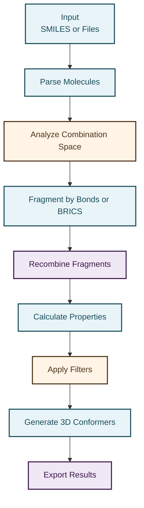
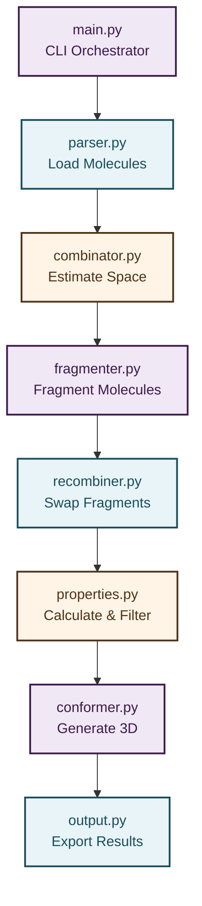
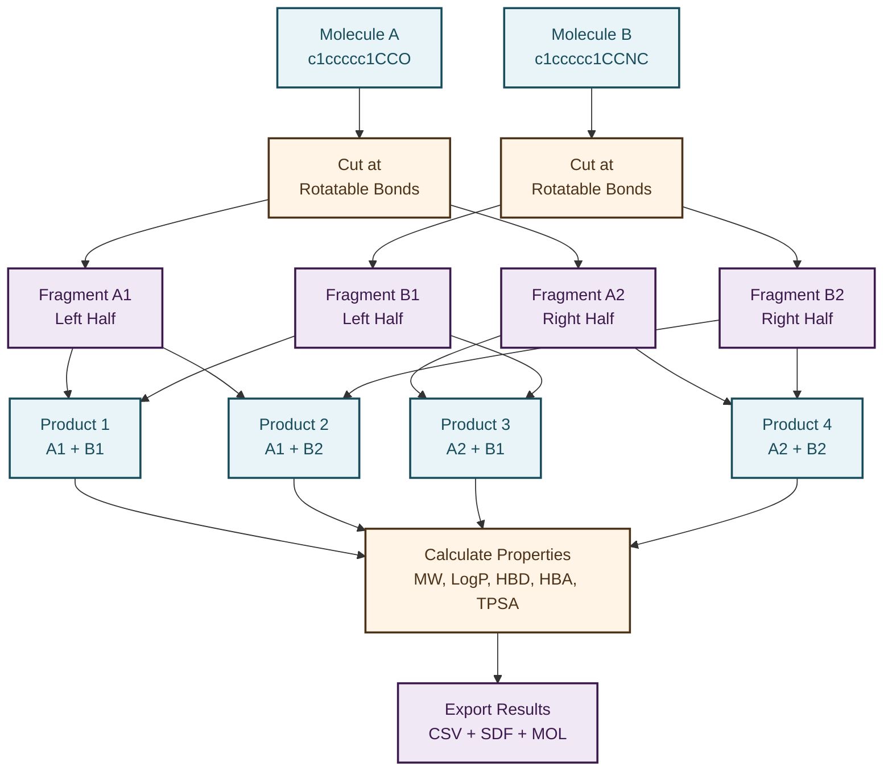
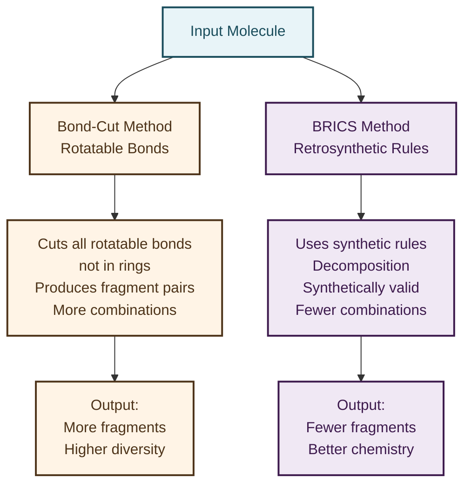
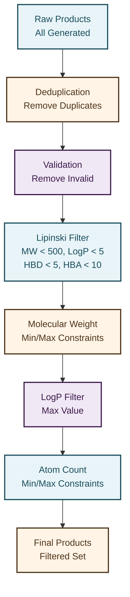
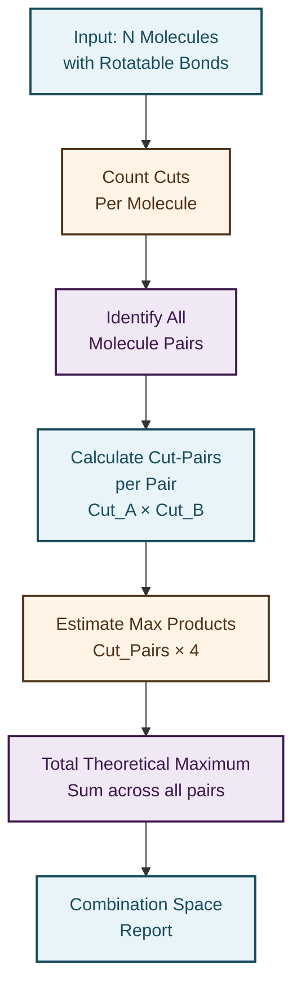

# MolSwapper

A modular toolkit for molecular fragment swapping and chimeric structure generation. MolSwapper takes a set of molecules, fragments each one, and recombines pieces across molecules to generate novel chimeric structures with full 3D conformers and molecular property calculations.

## Overview

MolSwapper automates the computational process of:

1. Parsing molecules from SMILES strings or files (`.txt`, `.csv`, `.smi`)
2. Analyzing the combinatorial space to estimate output before generation
3. Fragmenting molecules by rotatable bonds or BRICS retrosynthetic rules
4. Recombining fragments across all molecule pairs
5. Computing molecular properties (MW, LogP, HBD, HBA, TPSA, etc.)
6. Filtering products by Lipinski's Rule of Five, molecular weight, and other criteria
7. Generating energy-minimized 3D conformers using ETKDG and force fields
8. Exporting results to CSV, SDF (3D structures), individual .mol files, and grid images

For single molecule inputs, MolSwapper operates in self-recombination mode, fragmenting and recombining the molecule's own pieces in different arrangements.

## Core Pipeline Architecture



## Module Architecture



## Fragment Swapping Mechanism



## Fragmentation Methods



## Filtering Pipeline



## Combination Space Analysis



## Requirements

- Python 3.9 or higher
- RDKit (for molecular operations)
- Pillow (for image generation)

## Installation

```bash
git clone https://github.com/yourusername/MolSwapper.git
cd MolSwapper
pip install -r requirements.txt
```

## Quick Start

```bash
# Simple example with two molecules
python -m MolSwapper --smiles "c1ccccc1CCO" "c1ccccc1CCNC" -v

# From a CSV file
python -m MolSwapper -f molecules.csv --method bonds --deduplicate -v

# Full pipeline with all outputs
python -m MolSwapper -f molecules.csv --method both --deduplicate --lipinski \
  --sdf products.sdf --mol-dir mol_files/ --image grid.png -o results.csv -v

# Preview without generating
python -m MolSwapper -f molecules.csv --count-only
```

## Usage

### Input Options

| Flag | Description |
|------|-------------|
| `--smiles "SMI1" "SMI2" ...` | One or more SMILES strings directly on the command line |
| `--file FILE` or `-f FILE` | Path to an input file (`.txt`, `.csv`, or `.smi`) |

**File Format Examples:**

`.txt` or `.smi` — one SMILES per line, optional name after whitespace:
```
c1ccccc1CCO phenylethanol
c1ccccc1CCNC phenylethylamine
CC(=O)Oc1ccccc1C(=O)O aspirin
```

`.csv` — auto-detects columns named `smiles`/`smi`/`molecule` and `name`/`id`/`compound`:
```csv
smiles,name
c1ccccc1CCO,phenylethanol
c1ccccc1CCNC,phenylethylamine
```

### Fragmentation Methods

| Flag | Method | Description |
|------|--------|-------------|
| `--method bonds` | Bond-cut (default) | Cuts every rotatable single bond not in a ring. Produces fragment pairs with dummy atom attachment points. |
| `--method brics` | BRICS | Uses retrosynthetic BRICS rules to decompose into synthetically meaningful building blocks. |
| `--method both` | Both | Runs bond-cut and BRICS, combines all results. |
| `--max-products N` | | Maximum BRICS products per molecule pair (default: 50). |

### Filtering Options

| Flag | Description |
|------|-------------|
| `--deduplicate` | Remove duplicate products by canonical SMILES |
| `--lipinski` | Keep only products passing Lipinski's Rule of Five |
| `--min-weight N` | Minimum molecular weight |
| `--max-weight N` | Maximum molecular weight |
| `--min-atoms N` | Minimum heavy atom count |
| `--max-atoms N` | Maximum heavy atom count |
| `--max-logp N` | Maximum LogP value |

### 3D Conformer Options

| Flag | Description |
|------|-------------|
| `--sdf PATH.sdf` | Generate 3D conformers and save all products to an SDF file with full metadata |
| `--mol-dir DIRECTORY` | Save each product as an individual `.mol` file |
| `--num-conformers N` | Number of 3D conformers to generate per molecule (default: 1) |
| `--force-field MMFF\|UFF` | Force field for energy minimization (default: MMFF) |
| `--no-optimize` | Skip energy minimization |
| `--include-inputs` | Include original input molecules in the SDF file |

### Combination Analysis

| Flag | Description |
|------|-------------|
| `--count-only` | Only calculate and print the theoretical combination space, then stop |

### Output Options

| Flag | Description |
|------|-------------|
| `--output FILE` or `-o FILE` | Output CSV file path. If omitted, auto-generates filename with timestamp |
| `--image FILE.png` | Save a grid image of the first 24 product molecules |
| `--verbose` or `-v` | Print detailed results table to the console |

## Examples

**Two molecules with basic settings:**
```bash
python -m MolSwapper --smiles "c1ccccc1CCO" "c1ccccc1CCNC"
```

**Full pipeline with 3D conformers in SDF:**
```bash
python -m MolSwapper --smiles "c1ccccc1CCO" "c1ccccc1CCNC" \
  --deduplicate --sdf products.sdf --include-inputs -v
```

**Large library with all output formats:**
```bash
python -m MolSwapper -f library.csv --method both --deduplicate --lipinski \
  --sdf all_products.sdf --mol-dir mol_files/ --image grid.png -o results.csv
```

**Preview combination space before generating:**
```bash
python -m MolSwapper -f big_library.smi --count-only
```

**Multiple conformers with UFF force field:**
```bash
python -m MolSwapper --smiles "c1ccccc1CCO" "c1ccccc1CCNC" \
  --sdf output.sdf --num-conformers 5 --force-field UFF
```

**Single molecule self-recombination:**
```bash
python -m MolSwapper --smiles "CC(=O)Oc1ccccc1C(=O)O" --image products.png -v
```

**Filter by molecular weight and LogP:**
```bash
python -m MolSwapper -f molecules.txt --min-weight 150 --max-weight 400 --max-logp 3.0
```

## Output Formats

### CSV Columns

| Column | Description |
|--------|-------------|
| `product_id` | Unique identifier tracing which fragments were combined |
| `product_smiles` | Canonical SMILES of the generated molecule |
| `source_a` | Name of the first parent molecule |
| `source_b` | Name of the second parent molecule |
| `frag_a` | Fragment from molecule A |
| `frag_b` | Fragment from molecule B |
| `swap_type` | Which fragment halves were joined |
| `num_atoms` | Heavy atom count |
| `mol_weight` | Molecular weight |
| `logp` | Calculated LogP |
| `hbd` | Hydrogen bond donors |
| `hba` | Hydrogen bond acceptors |
| `tpsa` | Topological polar surface area |
| `rotatable_bonds` | Number of rotatable bonds |
| `num_rings` | Ring count |
| `lipinski_violations` | Number of Lipinski violations |

### SDF File Contents

Each molecule entry in the SDF file contains:
- 3D atomic coordinates (energy-minimized)
- All CSV properties embedded as SD tags
- Fragment origin tracking (parent molecule and cut information)
- Molecule name set to product_id for easy lookup

When `--include-inputs` is used, original input molecules appear at the top with `Role: input_molecule` for comparison.

### Individual .mol Files

With `--mol-dir`, each product gets its own `.mol` file named after its product_id. These are useful for loading into visualization tools such as PyMOL, UCSF Chimera, or Avogadro.

## Project Structure

```
MolSwapper/
├── __init__.py           # Package metadata
├── __main__.py           # Enables running as: python -m MolSwapper
├── main.py               # CLI entry point and orchestration
├── parser.py             # Input parsing from various formats
├── fragmenter.py         # Fragmentation engines (bond-cut and BRICS)
├── recombiner.py         # Fragment swapping and joining
├── properties.py         # Molecular descriptors and filtering
├── conformer.py          # 3D conformer generation
├── combinator.py         # Combination space analysis
├── output.py             # Export functions (CSV, SDF, MOL, images)
├── requirements.txt      # Python dependencies
├── setup.py              # Package configuration
├── README.md             # This file
├── LICENSE               # MIT License
└── CONTRIBUTING.md       # Contribution guidelines
```

## Using as a Library

Each module can be imported for custom workflows:

```python
from MolSwapper.parser import parse_molecules
from MolSwapper.fragmenter import fragment_by_bonds, fragment_by_brics
from MolSwapper.recombiner import bond_cut_recombine, brics_recombine
from MolSwapper.properties import enrich_results, deduplicate, filter_by_lipinski
from MolSwapper.conformer import generate_conformers_batch
from MolSwapper.combinator import calculate_bond_combinations
from MolSwapper.output import save_csv, save_sdf, save_individual_mol_files

# Parse molecules
mols = parse_molecules(smiles_list=["c1ccccc1CCO", "c1ccccc1CCNC"])

# Check combination space
report = calculate_bond_combinations(mols)

# Fragment and recombine
results = bond_cut_recombine(mols)

# Enrich with properties and filter
results = enrich_results(results)
results = deduplicate(results)
results = filter_by_lipinski(results)

# Generate 3D conformers
conformer_data = generate_conformers_batch(results, num_conformers=1, optimize=True)

# Save outputs
save_csv(results, "output.csv")
save_sdf(conformer_data, "output.sdf")
```

## Combination Space Report

The combination analysis runs automatically and shows:

```
------------------------------------------------------------
COMBINATION SPACE ANALYSIS
------------------------------------------------------------
Input molecules: 3
Molecule pairs:  3

Cuts per molecule:
  phenylethanol: 2 rotatable-bond cuts
  phenylethylamine: 3 rotatable-bond cuts
  aspirin: 3 rotatable-bond cuts

Pair breakdown:
  phenylethanol x phenylethylamine: 2 x 3 cuts = 6 cut-pairs -> up to 24 products
  phenylethanol x aspirin: 2 x 3 cuts = 6 cut-pairs -> up to 24 products
  phenylethylamine x aspirin: 3 x 3 cuts = 9 cut-pairs -> up to 36 products

THEORETICAL MAXIMUM: 84 possible molecules
(actual count will be lower after validity checks and deduplication)
------------------------------------------------------------
```

Use `--count-only` to see this report without running full generation. This is useful for large datasets to estimate output size.

## Fragment Swapping Formula

For N molecules with c_i rotatable-bond cuts each:

```
Total theoretical max = sum over all pairs (i,j): c_i * c_j * 4
Number of pairs = N * (N-1) / 2
```

Each cut-pair produces 4 possible products:
- A1 + B1 (left + left)
- A1 + B2 (left + right)
- A2 + B1 (right + left)
- A2 + B2 (right + right)

## License

MIT

## Contributing

See [CONTRIBUTING.md](CONTRIBUTING.md) for guidelines on contributing to this project.

## Development

For development setup and guidelines, see [DEVELOPMENT.md](DEVELOPMENT.md).

For a quick reference of all commands, see [QUICK_REFERENCE.md](QUICK_REFERENCE.md).
